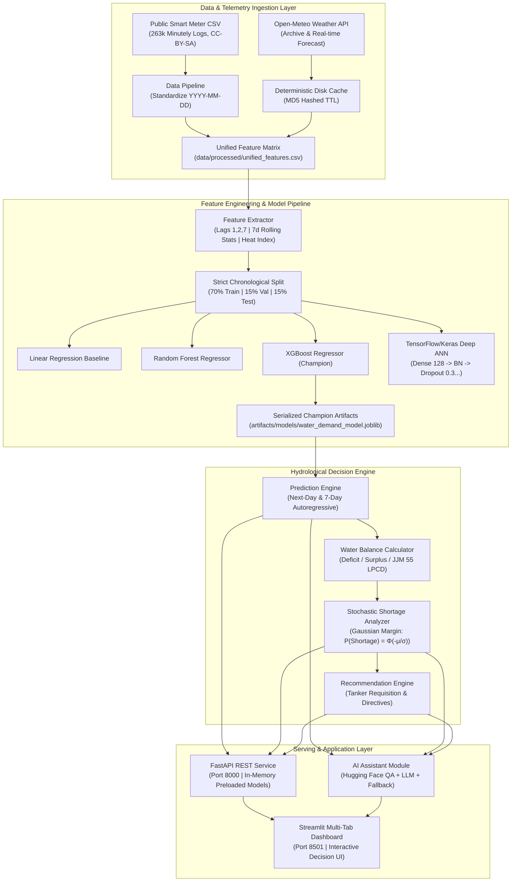
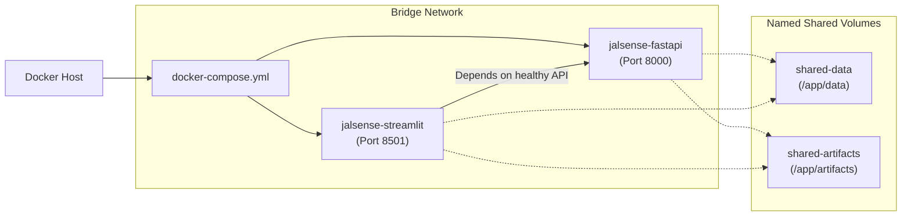

# JalSense System Architecture

## 1. High-Level Architectural Diagram

---

## 2. Layer-by-Layer Architecture

### 1. Data Ingestion & Caching Layer (`src/weather_client.py`, `src/data_pipeline.py`)
- Downloads and normalizes public smart water meter telemetry from `LukaLike/water-consumption-data` into clean daily totals.
- Queries Open-Meteo weather coordinates with local disk caching (`data/cache/weather/`) using MD5 request hashes.

### 2. Preprocessing & Feature Engineering Layer (`src/preprocessing.py`, `src/features.py`)
- Standardizes timestamps to ISO-8601 (`YYYY-MM-DD`).
- Generates 15 domain-informed features:
  - Demographic scale: Census population
  - Meteorology: Temperature, precipitation, relative humidity, Steadman heat index
  - Calendar factors: Day of week, weekend indicator, month, encoded agro-climatic season
  - Autoregressive memory: Lag 1, Lag 2, Lag 7 daily demands
  - Rolling windows: 7-day rolling mean, rolling standard deviation, rolling maximum

### 3. Model Training & Evaluation Engine (`src/models.py`, `run_pipeline.py`)
- Enforces strict chronological train/validation/test splitting (70% / 15% / 15%) without shuffling to eliminate temporal data leakage.
- Trains and benchmarks 4 architectures: Linear Regression, Random Forest, XGBoost, and TensorFlow Deep ANN with Batch Normalization and Dropout.
- Automatically selects and serializes the champion model based on holdout Mean Absolute Error (MAE).

### 4. Hydrological Water Balance & Shortage Engine (`src/shortage.py`)
- Computes transparent volumetric water balances: Demand, Available Supply, Storage Buffer, and Deficit/Surplus.
- Calculates shortage probability using a stochastic Gaussian margin ($M = [S + \alpha B] - D$).
- Categorizes risk into 4 tiers: `LOW`, `MODERATE`, `HIGH`, `CRITICAL`.
- Generates templated administrative advisories with required disclaimers.

### 5. Conversational AI Assistant Layer (`src/assistant.py`)
- Synthesizes structured prediction telemetry into an unambiguous situation briefing.
- Routes queries through configurable LLM APIs (`.env`), local Hugging Face Transformers (`distilbert-base-cased-distilled-squad`), or a deterministic zero-hallucination fallback engine.
- Explicitly labels every answer with its source attribution mode.

### 6. Serving Layer (`api/main.py`, `app/streamlit_app.py`)
- **FastAPI Backend (Port 8000):** Async REST API exposing health checks, weather endpoints, next-day demand prediction, shortage risk evaluation, scenario simulation, and multi-day forecasts. Pre-loads models into memory on boot to eliminate disk I/O on inference hits.
- **Streamlit Dashboard (Port 8501):** 7 interactive sections featuring Plotly visualizations, gauge charts, parameter sliders, holdout benchmark tables, and interactive conversational assistant.

---

## 3. Container Orchestration Architecture

