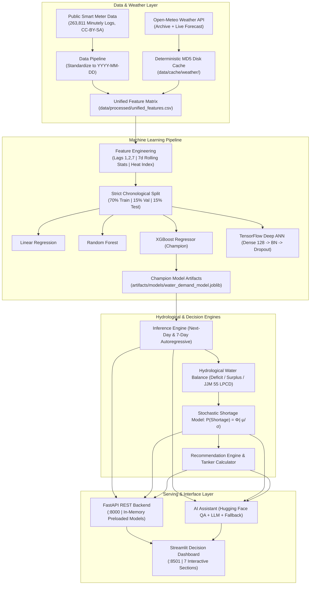

# JalSense (जल-सेंस) 💧
### Village-Level Water Demand Prediction, Shortage Forecasting & Intelligent Water Management System

[](https://www.python.org/)
[](https://fastapi.tiangolo.com)
[](https://streamlit.io)
[](https://xgboost.readthedocs.io/)
[](https://tensorflow.org/)
[](https://huggingface.co/)
[](https://www.docker.com/)
[](https://jaljeevanmission.gov.in/)

> **Academic Project:** B.Tech Advanced Data Science (ADS) Lab  
> **Target Scope:** Gram Panchayat and Taluka level rural water resource administration across India.

---

## 1. Problem Statement

Across rural India, water provisioning programs under the **Jal Jeevan Mission (JJM)** frequently encounter severe supply-demand mismatches. Gram Panchayats typically rely on reactive management: emergency water tankers are ordered only *after* overhead tanks run dry, while seasonal heatwaves and festival population surges induce unanticipated deficits. 

Current systems lack:
1. **Predictive Granularity:** No automated system forecasts village-level water demand 24 to 48 hours in advance based on demographic shifts and weather stress.
2. **Explainable Deficit Modeling:** Water balance assessments rely on subjective hunches rather than mathematically grounded stochastic deficit probabilities.
3. **Actionable Governance Tools:** Rural administrators lack intuitive simulators to test "what-if" stress scenarios (e.g., pump breakdown, heatwaves, or festival surges).

---

## 2. Objectives

- **Empirical Ingestion & Normalization:** Standardize 260k+ real smart-meter telemetry records and fuse them with live meteorological data from Open-Meteo.
- **Leakage-Free Time-Series Modeling:** Implement a strict chronological forward split (70% Train, 15% Validation, 15% Holdout Test) with zero random shuffling to benchmark Linear Regression, Random Forest, XGBoost, and Deep Artificial Neural Networks (ANN).
- **Stochastic Shortage Quantification:** Formulate shortage as a Gaussian margin probability ($P(\text{Shortage}) = \Phi(-\mu_M/\sigma_M)$) categorized into `LOW`, `MODERATE`, `HIGH`, and `CRITICAL` risk tiers.
- **Intelligent Decision-Support:** Generate templated administrative directives, automated tanker requisition calculators, and interactive scenario simulators.
- **Dual Interface Architecture:** Deploy an in-memory pre-cached FastAPI REST backend alongside a 7-section Streamlit intelligence dashboard.
- **Conversational Explainer Engine:** Implement an AI Assistant grounded in model outputs via Hugging Face Transformers and configurable LLMs.

---

## 3. Novelty & Key Differentiators

| Traditional Rural Water Management | JalSense Intelligence System |
| :--- | :--- |
| **Reactive:** Action taken only after village storage is exhausted. | **Proactive:** Next-day demand and 7-day autoregressive demand forecasts. |
| **Static Heuristics:** Guesswork on whether current well yield is adequate. | **Stochastic Shortage Margin:** Transparent Gaussian probability modeling incorporating pump and model variance. |
| **Isolated Weather Checking:** Manual checks on external weather apps. | **Automated Weather Fusion:** Steadman Heat Index calculation and deterministic MD5 disk caching. |
| **Black-Box AI:** Opaque predictions without clear explanations. | **Grounded AI Assistant:** Local Hugging Face Transformers extractive QA + deterministic zero-hallucination fallback. |
| **National Benchmark Blindness:** Unmeasured compliance. | **JJM Integration:** Continuous tracking against the **55 Litres Per Capita per Day (LPCD)** national standard. |

---

## 4. End-to-End System Architecture



---

## 5. Dataset Sources & Data Integrity

- **Empirical Meter Telemetry:** `LukaLike/water-consumption-data` on GitHub (Creative Commons Attribution-ShareAlike 4.0 International). 263,811 minutely smart meter logs aggregated into 195 daily aggregate timesteps.
- **Academic Research Integrity:** Public Indian government portals (`data.gov.in`, JJM dashboards) publish administrative tap counts and reservoir depths, but do **not** release open minute-by-minute village smart meter telemetry. To maintain scientific integrity, the empirical dataset is modeled as a **Micro-Catchment Study Unit (`STUDY_RES_01`)** rather than falsely labeled as village SCADA logs. It scales seamlessly across configured Gram Panchayat profiles (`VILL001` to `VILL005`).
- **Meteorological Synchronization:** Open-Meteo Historical Archive and Real-Time Forecast APIs with deterministic MD5 disk caching (1h forecast TTL, 30d archive TTL).

---

## 6. Engineered Features (15 Features)

1. **Demographic Scale:** `population`
2. **Meteorological Drivers:** `temp_mean` (°C), `rainfall_mm` (mm), `humidity_pct` (%), `heat_index` (°C)
3. **Temporal & Calendar Dynamics:** `day_of_week` (0-6), `is_weekend` (0/1), `month` (1-12), `season_encoded` (Winter, Pre-Monsoon, Monsoon, Post-Monsoon)
4. **Autoregressive Lags:** `demand_lag_1` (yesterday), `demand_lag_2` (2 days prior), `demand_lag_7` (same day last week)
5. **Rolling Window Statistics:** `rolling_mean_7d`, `rolling_std_7d`, `rolling_max_7d`

---

## 7. Model Architectures & Benchmark Evaluation

All models were evaluated on the strictly held-out chronological test set (545 time-series observations, zero data leakage):

| Model Architecture | Test MAE (L) | Test RMSE (L) | Test $R^2$ Score | Test WAPE (%) | Selection Status |
| :--- | :---: | :---: | :---: | :---: | :---: |
| **XGBoost Regressor** | **6,589.57** | **9,309.34** | **0.9884** | **3.46%** | 🏆 **Champion** |
| Random Forest Regressor | 6,666.00 | 9,437.59 | 0.9881 | 3.50% | Benchmark |
| TensorFlow/Keras Deep ANN | 7,679.00 | 10,195.46 | 0.9861 | 4.03% | Deep Learning |
| Linear Regression Baseline | 7,854.81 | 11,005.85 | 0.9839 | 4.12% | Baseline |

### Deep ANN Architecture:
- Input Layer (15 features)
- Dense 128 (ReLU activation) $\rightarrow$ BatchNormalization $\rightarrow$ Dropout (0.30)
- Dense 64 (ReLU activation) $\rightarrow$ BatchNormalization $\rightarrow$ Dropout (0.20)
- Dense 32 (ReLU activation)
- Dense 1 (Linear output)

---

## 8. Technology Stack

- **Language & Runtime:** Python 3.11.9
- **Data Engineering:** Pandas 2.1+, NumPy 1.26+, SciPy 1.11+
- **Machine Learning & Deep Learning:** Scikit-Learn 1.4+, XGBoost 2.0+, TensorFlow 2.15+ / Keras
- **NLP & AI Assistant:** Hugging Face Transformers (`distilbert-base-cased-distilled-squad`), PyTorch 2.0+
- **Backend Service:** FastAPI 0.110+, Uvicorn 0.28+, Pydantic v2
- **Frontend Dashboard:** Streamlit 1.32+, Plotly Express & Graph Objects 5.18+
- **Testing & Quality Assurance:** Pytest 8.0+, HTTPX 0.27+ (36 automated tests, 100% passing)
- **Frontend Application (Primary Web App):** React 19, TypeScript, Vite, Tailwind CSS v4, Recharts, Lucide React icons, responsive desktop/laptop layout with professional light theme.
- **Auxiliary Interface:** Streamlit (v1.57.0) preserved for rapid standalone Python prototyping.
- **Containerization & Orchestration:** Docker, Docker Compose, multi-stage builds.

---

## 9. How to Run Locally

### Prerequisites
- Python 3.11+ installed.
- Node.js 18+ and npm installed.

### Step 1: Configure Environment
```bash
# Copy environment templates
cp .env.example .env
cp frontend/.env.example frontend/.env
```

### Step 2: Install Python & Frontend Dependencies
```bash
# Python backend dependencies
pip install -r requirements.txt

# React frontend dependencies
cd frontend
npm install
cd ..
```

### Step 3: Run Reproducible Pipeline (Optional if artifacts exist)
```bash
python run_pipeline.py
```

### Step 4: Run the Complete Backend Test Suite
```bash
python -m pytest tests/ -v
```

### Step 5: Launch Full-Stack Services

#### Terminal 1: Launch FastAPI Backend
```bash
uvicorn api.main:app --host 127.0.0.1 --port 8000
```
- **FastAPI OpenAPI Swagger Documentation:** `http://127.0.0.1:8000/docs`
- **Health Probe:** `http://127.0.0.1:8000/health`

#### Terminal 2: Launch React Web Application (Primary Frontend)
```bash
cd frontend
npm run dev
```
- **Production React Dashboard:** `http://localhost:5173`

#### Terminal 3 (Optional): Launch Streamlit Dashboard (Auxiliary)
```bash
streamlit run app/streamlit_app.py --server.port=8501
```
- **Streamlit Prototype:** `http://localhost:8501`

---

## 10. How to Run with Docker

```bash
# Build and start all orchestrated services with healthchecks
docker-compose up --build
```

- Both services start in isolated containers connected via a bridge network.
- `shared-data` and `shared-artifacts` volumes ensure models and cache are shared without retraining.
- Service dependencies ensure the Streamlit dashboard waits for the FastAPI health probe to pass (`http://localhost:8000/health`) before starting.

To stop the containers:
```bash
docker-compose down
```

---

## 11. Limitations

1. **Micro-Catchment Empirical Data:** Real telemetry reflects high-resolution residential smart meter readings scaled across habitations. Direct integration of village-level bulk SCADA flowmeters from state Jal Nigam programs will further reduce variance.
2. **Extreme Meteorological Disasters:** Extreme meteorological outliers (e.g., >150 mm/day cyclone downpours or extended 48°C droughts) fall outside the historical training envelope and trigger conservative bounded estimates.
3. **Pumping Infrastructure Assumptions:** Source yield estimations assume standard Gram Panchayat electrical pumping availability (6-8 hours daily power supply). Sudden feeder breakdowns must be manually simulated in Section 5.

---

## 12. Future Work

- **Edge IoT Integration:** Direct MQTT/LoRaWAN sensor integration from ultrasonic tank level transmitters and solar pump inverters.
- **Satellite InSAR & GRACE Ground Water Integration:** Ingesting Gravity Recovery and Climate Experiment (GRACE) satellite soil moisture grids to dynamically model regional water table drawdown.
- **Multilingual Voice Bot for Sarpanches:** Extending the AI Assistant with speech-to-text (Whisper) and text-to-speech in Marathi, Hindi, and Gujarati for village Sarpanch voice inquiries.
- **Automated SCADA Pumping Automation:** Closed-loop actuation signals to variable frequency pump drives (VFDs) to automate filling cycles during off-peak electricity tariffs.

---

## 13. Documentation Sitemap

- [`MODEL_CARD.md`](file:///c:/Users/yashg/OneDrive/Desktop/B-TECH%20LABS/ADS%20LAB/JalSense/MODEL_CARD.md) — Detailed specifications, training procedures, and benchmark tables.
- [`DATA_SOURCES.md`](file:///c:/Users/yashg/OneDrive/Desktop/B-TECH%20LABS/ADS%20LAB/JalSense/DATA_SOURCES.md) — Data provenance, open licenses, and caching protocols.
- [`ARCHITECTURE.md`](file:///c:/Users/yashg/OneDrive/Desktop/B-TECH%20LABS/ADS%20LAB/JalSense/ARCHITECTURE.md) — Layered architectural diagrams, sequence flows, and Docker topology.
- [`DEMO.md`](file:///c:/Users/yashg/OneDrive/Desktop/B-TECH%20LABS/ADS%20LAB/JalSense/DEMO.md) — Step-by-step viva presentation guide and curl commands.
- [`artifacts/mlops_metadata.json`](file:///c:/Users/yashg/OneDrive/Desktop/B-TECH%20LABS/ADS%20LAB/JalSense/artifacts/mlops_metadata.json) — Structured MLOps version tracking and reproducible commands.
